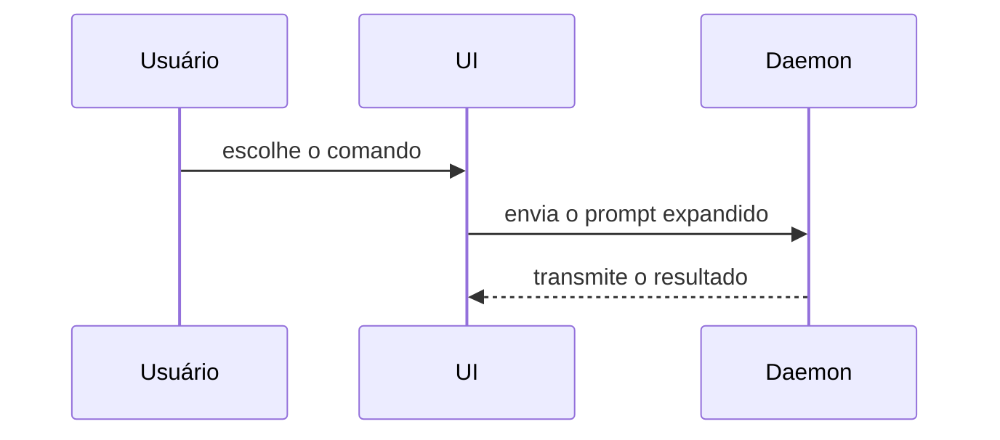

Use este modelo para escrever o corpo do PR:

```markdown
## Resumo

<diagrama, esboço de diff ou árvore>

## Evidência

- **Antes:** <screenshot/saída/execução de teste falhando>
  **Depois:** <screenshot/saída/execução de teste passando>

## Risco do merge

**Porta:** <mão única ou mão dupla>

<opcional: descrição>

**Blast radius:** <descrição em uma palavra>

<opcional: possíveis consequências do merge>
```

## Seções

Pule qualquer preâmbulo e mantenha a prosa breve. Use a linguagem de domínio do usuário, do `GLOSSARY.md`.

### Resumo

Escolha a menor visualização que deixa o ponto principal claro.

- Mostre lógica ou um algoritmo como pseudocódigo:

```text
ao(salvar)
  se o conteúdo não mudou
    retorna o resultado em cache
  grava o conteúdo novo
  retorna o resultado novo
```

- Mostre o fluxo de controle em tempo de execução como uma árvore de chamadas:

```text
submitForm
  createSession
    persistPrompt
    launchAgent
  navigateToSession
```

- Mostre a estrutura da UI como uma árvore de componentes, incluindo o estado e as fronteiras de módulo que importam:

```text
<SessionPage> (apps/example/src/routes/session.tsx)
  useSessionEvents()
  <SessionToolbar>
    <RunSkillButton> (packages/ui)
```

- Mostre a responsabilidade dos arquivos ou uma refatoração ampla como uma árvore de arquivos rasa:

```text
src/
├── commands/       # interpreta as ações do usuário
├── sessions/       # detém o estado da sessão
└── transport/      # envia as requisições de API
```

- Mostre interação entre componentes, fluxo de controle ou fluxo de dados com Mermaid:



- Use `diff` quando a questão for o que muda e a forma ao redor já existir. Ajuste o formato do diff ao assunto.

Para uma mudança de componente:

```diff
 <SessionPage>
   useSessionEvents()
   <SessionToolbar>
+    <RunSkillButton />
   <SessionTimeline>
+    <SkillResultCard />
```

Para uma mudança na organização de arquivos:

```diff
 src/
 ├── commands/
+│   └── show-me.ts       # expande o comando de barra
 ├── sessions/
-└── transport.ts
+└── transport/
+    ├── client.ts
+    └── stream.ts
```

Para uma mudança na árvore ou pilha de chamadas:

```diff
 submitForm
   createSession
     persistPrompt
+    expandSkillMention
     launchAgent
-  navigateToSession
+  navigateToSession
+    subscribeToEvents
```

Para uma mudança de estado ou de fluxo de controle:

```diff
 ao(salvar)
-  grava o conteúdo
+  se o conteúdo não mudou
+    retorna o resultado em cache
+  grava o conteúdo novo
+  invalida o cache
```

- Mostre o bloco inteiro quando a maior parte for nova, quando omitir o contexto esconderia a quem pertence algo ou a ordem, ou quando o usuário precisar de uma forma-alvo copiável:

```ts
function expandSkill(command: string): string {
  const skillName = command.slice(1);
  return `use the ${skillName} skill`;
}
```

#### Orientação

Coloque cada visual ao lado do texto curto que ele sustenta. Mantenha só as chamadas, arquivos, props, estados e fronteiras necessários para responder a pergunta atual do usuário ou as opções para resolver o ponto em discussão.

Você pode usar um destes, pode usar vários, dificilmente vai usar todos. Use o seu julgamento e não sobrecarregue o usuário.

### Evidência

Evidência concreta de que a mudança funciona. Mostre um antes e um depois.

Screenshots são nível S, quando o ambiente estiver preparado para isso e a mudança for visual.

Evidência baseada em execução é nível A. Resultados de teste, saída de console. Mostre o teste exato que agora falha e passa, em pseudocódigo.

### Risco do merge

Diga se é uma porta de mão única ou de mão dupla. Dá para voltar por portas de mão dupla, mas não por portas de mão única. Um PR barato de reverter é de menor risco. Mudanças que envolvem ações destrutivas ou decisões difíceis de reverter são portas de mão única.

O blast radius é o impacto ou escopo potencial das mudanças introduzidas por este PR. Considere todas as possibilidades. Exemplos: deslocamento de layout, quebras para quem consome, responsividade no celular etc.
